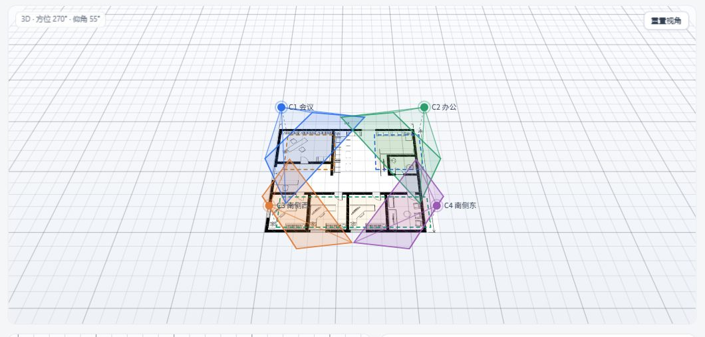
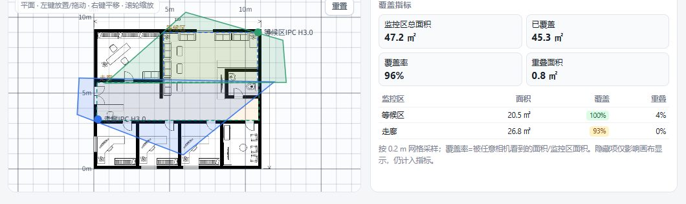
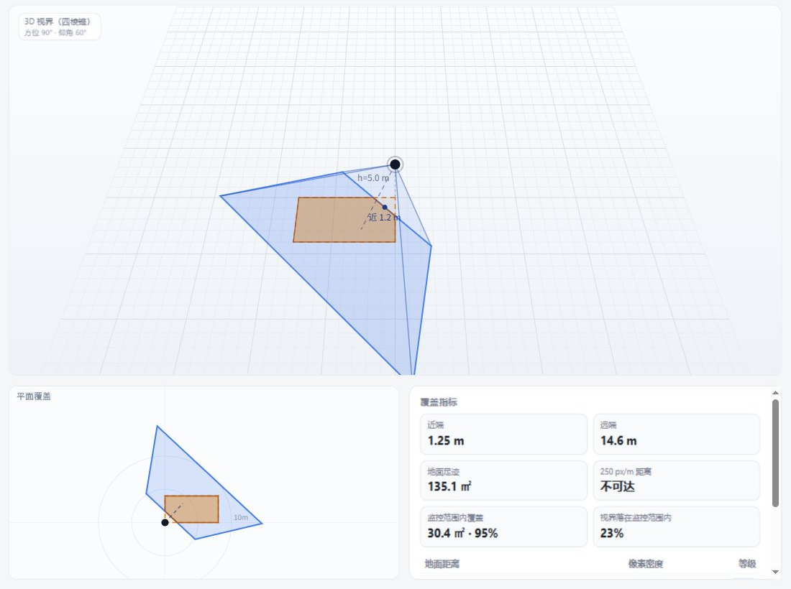

# IPCS FOV Planner · 摄像头视界规划器

本地优先的 3D 摄像头覆盖规划工具：上传户型图，放置多台相机和监控区，自动计算最佳安装角度，输出覆盖率、像素密度和可直接交给施工的配置单。

纯前端、无后端、无第三方依赖。平面图、相机参数和计算结果全部留在浏览器里，不上传任何数据。

**在线演示**：<https://chaosg.github.io/ipcs-fov-planner/>（打开后点「加载示例」）





## 功能

### 多相机规划器（`index.html`，主页面）

- **底图**：上传 PNG/JPG 户型图，输入图宽实际长度自动标定 m/px；支持 X/Y 偏移，把底图左下角放到任意世界坐标；底图存 IndexedDB，重传覆盖。
- **标尺网格**：1 m 细线、5 m 粗线，平面图铺满视口，3D 随视角无限延伸。
- **多相机**：平面图点击放置、拖动移动，或直接改 X/Y 坐标；每台可设高度、水平/垂直视场角、分辨率、偏航/俯仰/滚转、负责监控区、颜色、镜头预设（2.8/4/6/8 mm）。
- **多监控区**：拖出矩形，可改名称、坐标、长宽、颜色，支持单独删除。
- **自动分配**：未指定区的相机按到监控区的最近距离自动分配，可手动改。
- **单机寻优**：选中一台相机后，在它的负责区内搜索偏航/俯仰/滚转，优先全覆盖；覆盖相同时，视界利用率（区内覆盖面积/地面足迹面积）越大越好，结果只写回该相机。
- **3D 视界**：完整四棱锥（顶点 + 4 条棱 + 四个侧面 + 地面截面），可旋转、平移、缩放；右上角一键重置视角。
- **指标**：近端/远端、地面足迹、250 px/m 距离、监控区内覆盖、视界落在范围内的比例、重叠面积；按 0.2 m 网格采样。
- **导入/导出**：配置 JSON（含底图，可迁移/备份）；配置单 CSV（相机参数 + 分区覆盖率，Excel 直接打开）。
- **示例场景**：内置示例户型图 + 2 台相机 + 2 个监控区（等候区、走廊），点「加载示例」即可体验。
- **持久化**：相机/监控区/标定存 localStorage，底图存 IndexedDB。

### 单相机模拟器（`simulator.html`）

- 输入 H/V 视场角、分辨率、安装高度、俯仰、偏航、滚转，实时查看四棱锥与地面截面。
- 单个监控矩形 + 3 自由度自动寻优。
- 像素密度表（5/10/15/20/30 m）与 DORI 等级。



## 快速开始

方式一：直接双击 `index.html`（经典脚本，无需构建）。

方式二：起一个本地静态服务（Cookie/IndexedDB 在 `file://` 下可能受限，用 http 更稳）：

```bash
git clone https://github.com/ChaosG/ipcs-fov-planner.git
cd ipcs-fov-planner
python3 -m http.server 8080
# 或 npm start / npx serve .
```

打开 <http://127.0.0.1:8080/>。

## 规划器使用流程

1. **上传底图**，填「图宽实际长度」，网格和比例自动生成；需要时用 X/Y 偏移对齐坐标原点。
2. **画监控区**：点「＋ 画监控区」，在平面图上拖出矩形。
3. **放相机**：点「＋ 放相机」，在平面图上点击；拖动相机点或改 X/Y 坐标调整位置。
4. **自动分配区**：把未指定区的相机分配到最近的监控区（可手动改）。
5. **优化选中相机**：选中一台相机，点「优化选中相机」，只对该相机搜索最佳偏航/俯仰/滚转。
6. **看指标 / 导出**：覆盖率达到预期后，导出配置 JSON 和配置单 CSV。

### 操作

- 平面图：左键选中/放置/拖动；右键、中键或 Shift+左键平移；滚轮以鼠标位置缩放；右上角「重置」恢复适配。
- 3D：左键旋转、右键/中键/Shift+左键平移、滚轮缩放；右上角「重置视角」。
- 隐藏：列表右侧眼睛按钮隐藏相机或监控区，只影响画布显示，仍计入覆盖指标；「全部显示」一键恢复。

## 模型说明

- 视场角与焦距：`θ = 2·arctan(d / 2f)`，d 为传感器对应方向的有效尺寸；同一传感器下 `f·tan(θ/2)` 为常数。
- 四棱锥：以相机为顶点，水平半角 H/2、垂直半角 V/2，绕光轴可滚转；与 z=0 平面求交得到地面足迹。
- 俯仰角从水平面起算，90° 为垂直向下；偏航从 +X 轴逆时针，范围 -180°–180°；滚转绕视界中心线，范围 -90°–90°。
- 像素密度：`px/m = 分辨率宽 / (2·斜距·tan(H/2))`；DORI 阈值取 250/125/62.5/25 px/m。
- 寻优目标：监控区覆盖率最大 → 视界利用率最大（区内覆盖面积 / 地面足迹面积）。偏航从 -180°、滚转从 -90° 开始搜索；单台采用候选带 + 多起点局部搜索，降低陷入局部最优的概率。

## 文件结构

```
ipcs-fov-planner/
├── index.html          # 多相机规划器（主页面）
├── simulator.html      # 单相机模拟器
├── planner.html        # 兼容旧链接的跳转页
├── assets/
│   ├── geometry.js     # 公共几何/投影（两页共用）
│   ├── planner.css / planner.js
│   └── style.css / app.js
├── docs/               # README 截图
├── pictures/           # 示例户型图与示例配置（example.json）
├── package.json
├── LICENSE
└── README.md
```

## 已知限制

- 未建模遮挡：墙、屋檐、围栏不会挡住视界。
- 3D 底图用 16×16 网格仿射贴图，大角度斜视有轻微透视扭曲。
- 监控区目前只支持矩形；寻优每次只优化选中的一台相机，采用多起点局部搜索，不保证数学全局最优，也不保证多台联合最优。
- 寻优的滚转是纯几何最优，可能给出 130°–300° 的解（画面会横置）；实际安装建议限制在 ±15° 内。
- 界面为中文；移动端触控尚未专门适配。

## License

MIT © 2026 ChaosG

---

# English

**IPCS FOV Planner** is a local-first, 3D camera coverage planner for CCTV/IP camera layouts.

Upload a floor plan, place multiple cameras and monitoring zones, and let the tool compute the best yaw/pitch/roll for each camera. It reports ground coverage, pixel density (DORI), overlaps and blind spots, and exports a JSON project or a CSV configuration sheet.

Everything runs in the browser: no backend, no dependencies, no uploads.

**Live demo**: <https://chaosg.github.io/ipcs-fov-planner/> — click “加载示例” (Load demo).

### Highlights

- True 3D rectangular pyramid (H/V FOV + pitch/yaw/roll), not a flat 2D wedge.
- Ground intersection, coverage %, pixel density and 250 px/m distance.
- Multiple cameras and rectangular zones; nearest-zone auto assignment.
- Per-camera 3-DOF optimizer: full coverage first, then smallest footprint.
- Floor plan underlay with 1 m / 5 m grid, pan/zoom, X/Y origin offset.
- Import/export JSON (with embedded floor plan) and CSV configuration sheet.
- Single-camera simulator page for lens/angle exploration.

### Quick start

Open `index.html` directly, or serve the folder:

```bash
python3 -m http.server 8080
```

Then visit <http://127.0.0.1:8080/>.

### Controls

- Plan: left-drag to place/move; right-drag, middle-drag or Shift+left-drag to pan; wheel to zoom.
- 3D: left-drag orbit; right-drag / Shift+drag pan; wheel zoom.

### License

MIT © 2026 ChaosG
